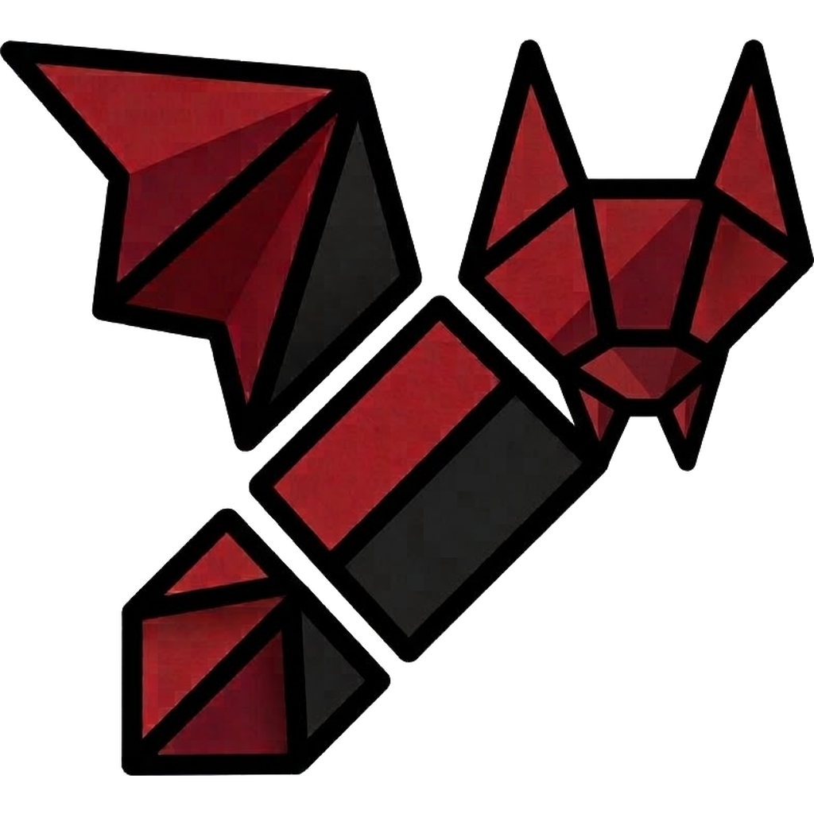

# Aves-X

**A private Android gallery based on [Aves](https://github.com/deckerst/aves).**

`ALPHA — testing`

---

## What is Aves-X?

**Aves-X** is an experimental fork of Aves that adds an extra layer of **privacy, security, and customization** to the original gallery.

It keeps Aves' core features — media viewer, albums, metadata, tags, maps, trash, and vaults — while adding controls to protect your photos and videos, and to decide when they are allowed to leave the app.

> ⚠️ **Aves-X is currently in alpha.** It may contain bugs, and some features are experimental. Keep backups of your important files.

## Features

### 🔐 Security

- **Master Code** — primary credential required to change or remove security protections. It is never stored in plain text.
- **Master Guard** — optional protection for credentials using Argon2id with a random salt per credential.
- **App Lock** — protects access to the app with a PIN and optional biometrics.
- **Failed Attempt Protection** — cooldowns that grow with every wrong attempt (configurable maximum, immune to changing the phone clock) and an optional emergency wipe after too many failures.
- **Fail-Safe** — always-on local crash diagnosis (nothing is sent anywhere), a safe mode after failures that blocks weakening security, opening or deleting vaults and deleting photos, and a lockdown screen that only the Master Code lifts when someone keeps guessing your codes.
- **Master Code cannot self-destruct the app** — during a lockdown, a correct Master Code is never counted as a failed attempt, so it cannot trigger the emergency wipe.
- **Nuke** — manual or automatic emergency wipe for vaults and their contents. Keys are destroyed first, so an interrupted wipe still leaves nothing readable.
- **Panic PIN** — triggers an emergency wipe while showing a fake incorrect-PIN screen.
- **Encrypted Vaults** — experimental AES-256 encryption for files stored inside vaults.

### 🚪 Gargantua — exit control

Security apps usually stop other people from getting *in*. Gargantua decides when your files are allowed to get **out**.

- **Grouped exit policy** — sharing, export/save, clipboard, open-with/edit, and cast/surfaces, with one master switch and a Master Code rule (seven switches in total, not dozens).
- **Sharing asks for the Master Code** by default, reusing the same guard as locked items.
- **Fail-closed** — if the policy cannot be read, the exit is blocked instead of allowed.

### 🕵️ Privacy

- **Protected Albums** — locks entire albums and hides their thumbnails.
- **Protected Photos & Favourites** — protects individual items without locking an entire album.
- **Advanced Vaults** — adds an additional lock, sharing protection, and the ability to hide vaults from the album list.
- **Protected Trash** — prevents unauthorized access to deleted files.
- **Hidden Items** — access hidden content through a secret gesture.
- **Safe Deletion** — additional confirmation steps help prevent accidental deletion.
- **Independent Privacy Controls** — each privacy feature can be enabled or disabled separately.

### 🧹 Automation

- **Automatic Deletion** — automatically removes photos and videos after a configured period.
- **Automatic Trash Cleanup** — configure when the trash is emptied.
- **Protected Settings** — sensitive configuration changes require the Master Code.

### 🎨 Customization

- **Nebula themes** — 19 choices with dedicated palettes and visual identities:
  - **Nosferatu Glass** — ruby crystal and black glass.
  - **Obsidian Glass** — volcanic black glass with violet fissures.
  - **Aureate Glass** — an antique-gold ceremonial relic.
  - **Forge Glass** — molten metal swirling inside an indigo forge.
  - **Hermetic Glass** — precise emerald/violet alchemical geometry.
  - **Eclipse Glass** — a dark occulting disc and electric-cyan corona.
  - **Solar Flare Glass** — stellar plasma arcs and outward ejections.
  - **Void Glass** — an acid-green technical grid converging into emptiness.
  - **Crimson Glass** — a dense garnet orb with a slow heartbeat.
  - **Neon Glass** — separate magenta/cyan tubes over reflective black.
  - **Emerald Glass** — forest-green mineral with branching golden veins.
  - **Aurora Glass** — long polar ribbons in green and ice blue.
  - **Sapphire Glass** — sharply faceted royal-blue crystal.
  - **Amber Glass** — honey resin with fossil-like inclusions.
  - **Onyx Glass** — minimal black stone with a graphite sweep.
  - **Pearl Glass** — a genuinely light nacre surface with pastel iridescence.
  - **Ivory Glass** — warm paper/porcelain with champagne filigree.
  - **Imperial Glass** — gunmetal plates, brass rivets and insignia gold.
  - **Aves** — the original adaptive light/dark appearance.
- **Nebula tab** — a dedicated galactic settings page with atmospheric VFX and a selector for all 19 themes.
- **Custom Navigation Bar** — multiple navigation styles to personalize the interface.
- **Nav Lens** — glass-lens effect over the active navigation section.
- **Glass-Everywhere** — experimental frosted glass throughout the interface, including the NEW/Experimental feature stickers.
- **Performance Mode** — reduces animations and visual effects for lower-end devices; the Nebula backdrop pauses completely.

### ⚡ Performance & Utilities

- **Extended Metadata Removal** — additional metadata removal support for non-animated PNG and WebP files.
- **Viewer & Selection Controls** — protect photos and albums directly from the viewer or selection interface. Locked photos are skipped when swiping.
- **Captions** — add your own text to any photo or video (for example "mom photo 17/11/2017") and find it from the search page. Stored in the app, files are never modified.
- **`.nomedia` Control** — create or remove `.nomedia` for a folder from the Explorer, and optionally list every folder, including hidden ones.
- **Swipe Between Tabs** — swipe horizontally to move between the main sections.
- **Video Player** — loop button, brightness and volume gestures, and decoder modes (software, hardware, hybrid) plus advanced player options.

## Privacy by design

- **No telemetry, no analytics, no cloud account.** Aves-X does not include Firebase, Crashlytics, or Google services.
- **No API keys required.** The app works offline; the repository does not ship credentials or signing keys.
- **Local diagnostics only.** Fail-Safe reports stay on the device unless you choose to copy and share them.

## Roadmap

See [ROADMAP.md](ROADMAP.md) for the full development roadmap.

## Based on Aves

Aves-X is an **experimental fork and tribute to [Aves](https://github.com/deckerst/aves)**, the open-source Android gallery created by **Thibault Deckers** and developed with its contributors.

Aves-X uses a significant part of Aves' foundation and functionality. Credit for that foundation belongs to the original project and its contributors.

If you are looking for a complete, stable, and actively maintained gallery, consider using **Aves**.

## Credits & License

- **Aves** © Thibault Deckers and contributors.
- Aves-X retains Aves' **BSD 3-Clause** license. See [LICENSE](LICENSE).
- Aves-X is not affiliated with or endorsed by the original Aves author.
- Modifications in this fork are maintained by [@Techkron-star](https://github.com/Techkron-star).
- The Aves-X logo is based on the project's own bat artwork.

---

Español

**Aves-X** es un fork experimental de [Aves](https://github.com/deckerst/aves) que añade una capa adicional de **privacidad, seguridad y personalización** a la galería de Android.

Mantiene las funciones principales de Aves — visor, álbumes, metadatos, etiquetas, mapas, papelera y vaults — y añade controles para proteger tus fotos y vídeos, y para decidir cuándo pueden salir de la app.

> ⚠️ **Aves-X está en alpha.** Puede tener fallos y algunas funciones son experimentales. Mantén copias de seguridad de tus archivos importantes.

### Características

- 🔐 **Código Maestro**, bloqueo de aplicación y autenticación biométrica. El Código Maestro nunca se guarda en texto plano.
- 🛡️ **Master Guard**: protección opcional de credenciales con Argon2id y sal aleatoria por credencial.
- 💣 **Borrado de emergencia** manual y automático, con destrucción de claves primero. Un Código Maestro correcto durante el lockdown nunca cuenta como fallo.
- 🕵️ **Álbumes, fotos, favoritos y papelera protegidos**; vaults avanzadas con cifrado opcional.
- 🚪 **Gargantua**: control de salidas por categorías (compartir, exportar, portapapeles, abrir con, cast), con interruptor maestro y regla de Código Maestro. Compartir pide credencial.
- 🧹 **Borrado automático** de contenido y papelera.
- 🎨 **Nebula Engine**: 19 temas con paletas, superficies y VFX propios: Aves, Nosferatu, Obsidian, Aureate, Forge, Hermetic, Eclipse, Solar Flare, Void, Crimson, Neon, Emerald, Aurora, Sapphire, Amber, Onyx, Pearl, Ivory e Imperial. Pearl e Ivory son temas claros reales; los efectos respetan el modo de rendimiento y el movimiento reducido.
- 🦇 **Logo exacto** de Aves-X en el launcher, el splash, la bienvenida, el cajón y Acerca de; icono adaptativo con variante monochrome para Material You.
- 🏷️ **Pegatinas NEW/Experimental** con tratamiento de cristal.
- ⚡ **Modo rendimiento** para dispositivos modestos; pausa las animaciones del Nebula Engine.
- 📝 **Compatibilidad ampliada** para eliminar metadatos.

### Privacidad por diseño

- **Sin telemetría, analíticas ni cuenta en la nube.** No incluye Firebase, Crashlytics ni servicios de Google.
- **No necesita claves de API.** La app funciona sin conexión y el repositorio no incluye credenciales ni claves de firma.
- **Diagnóstico local.** Los informes de Fail-Safe se quedan en el dispositivo salvo que decidas copiarlos y compartirlos.

**Estado:** Alpha — experimental y en desarrollo activo.

Mantén copias de seguridad de tus archivos importantes. Algunas funciones de seguridad, como el borrado de emergencia, son intencionalmente irreversibles.

Consulta [ROADMAP.md](ROADMAP.md) para conocer las funciones previstas.

