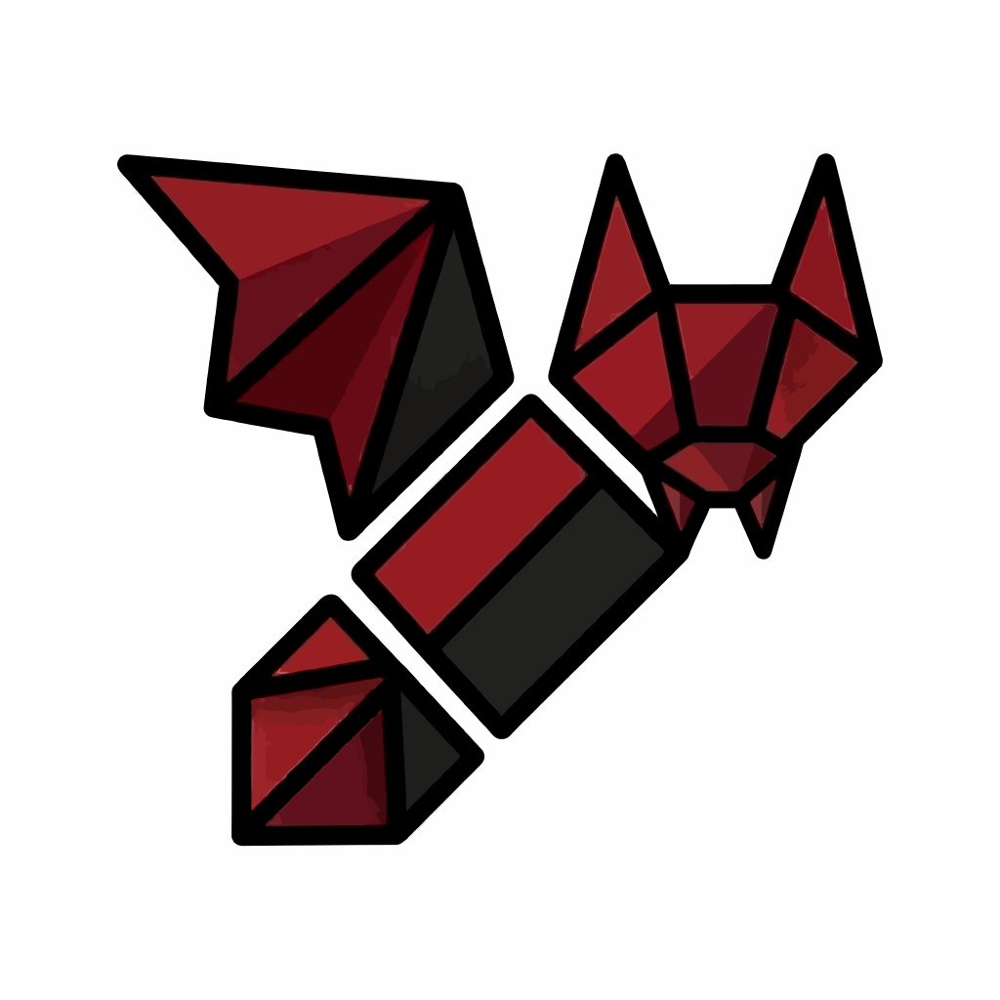

# Aves-X

**Galería privada para Android, basada en [Aves](https://github.com/deckerst/aves).**

`BETA 0.5 — pruebas públicas`

---

## Qué es Aves-X

Aves-X es un fork de Aves centrado en **privacidad, controles de seguridad y personalización visual**. Conserva el visor y la gestión de medios de Aves, y añade protecciones opcionales para fotos, álbumes, papelera y vaults.

> **Estado beta:** puede contener errores y no sustituye una auditoría de seguridad. Haz copias de seguridad antes de activar funciones irreversibles. Las protecciones nuevas y experimentales son opcionales salvo que se indique lo contrario.

## Características

### Galería y herramientas
- Visor de fotos y vídeos, álbumes, favoritos, etiquetas, búsqueda, mapas y explorador.
- Subtítulos/captions locales para encontrar fotos y vídeos sin modificar los archivos.
- Borrado de metadatos desde el visor o selección, para formatos compatibles.
- Control de `.nomedia`, papelera de 30 días y tareas de medios.
- Reproductor con controles de brillo/volumen por gestos, salto por doble toque, bucle y opciones de decodificación.

### Privacidad y seguridad
- **Bloqueos protegidos:** álbumes, fotos y favoritos, papelera, elementos ocultos y vaults.
- **Código Maestro** para acciones sensibles y gestión de credenciales; no existe recuperación si se pierde.
- **Master Guard opcional:** hashing Argon2id con sal aleatoria para credenciales.
- **Bloqueo de app:** PIN y biometría opcional, con retardo de rebloqueo.
- **Protección de intentos fallidos:** contadores persistentes, espera progresiva y lockdown; borrado de emergencia opcional. El borrado es irreversible.
- **Vaults cifradas experimentales:** cifrado de archivos con claves protegidas por Android Keystore. Mantén una copia independiente de los archivos importantes.
- **Fail-Safe local:** registro de errores en el dispositivo, modo seguro tras cierres inesperados y protección frente a cambios peligrosos. Los informes solo salen del teléfono si decides compartirlos.
- **Gargantua:** controles para limitar la entrega/compartición de contenido; la cobertura de salidas sigue siendo parcial.
- **Gargantuan / Black Hole:** modo root experimental y estética de agujero negro. El borrado asistido por root depende del dispositivo y no debe tratarse como garantía de destrucción forense.

### Personalización — Nebula Engine
- Temas con identidad propia, incluidos **Nosferatu Glass, Nox Terroris, Obsidian Glass, Aureate Glass, Forge Glass, Hermetic Glass, Eclipse, Solar Flare, Void, Crimson, Neon, Emerald, Aurora, Sapphire, Amber, Onyx, Pearl, Ivory, Imperial, Abyssal y Sakura**, además del aspecto Aves.
- **Nav Lens** con lente de cristal deslizante y cadenas animadas durante el desbloqueo.
- **Glass-Everywhere** como capa de cristal esmerilado independiente del tema.
- Temas Nebula personalizados: edición e importación/exportación local.
- Modo rendimiento y respeto a las preferencias de animación para reducir efectos costosos.

## Privacidad por diseño
- Sin telemetría ni analítica añadida por Aves-X; no se incluyen Firebase ni Crashlytics.
- Fail-Safe realiza diagnósticos locales: no envía los registros automáticamente.
- Sin cuenta en la nube ni claves de API propias necesarias para las funciones de privacidad.

## Beta 0.5 y trabajo pendiente

Esta beta prioriza la identidad visual de Nebula, el contraste por tema, la separación de ajustes, Nav Lens/cadenas, Fail-Safe y Gargantuan. No significa que el roadmap de seguridad esté completo: la cobertura total de salidas de Gargantua, el hardening de cachés/previews/intents y las pruebas de estrés/dispositivo siguen siendo trabajo pendiente.

Consulta [ROADMAP.md](ROADMAP.md) y [CHANGELOG.md](CHANGELOG.md). Descarga y novedades de versión se publican en [GitHub Releases](https://github.com/Techkron-star/aves-X/releases).

## Créditos y licencia

Aves-X es un fork personal basado en **[Aves](https://github.com/deckerst/aves)**, la galería de código abierto creada por Thibault Deckers y sus colaboradores. Los créditos de la base original se mantienen. Aves-X retiene la licencia BSD 3-Clause (consulta [LICENSE](LICENSE)); no está afiliado ni avalado por el autor original.

---

English

# Aves-X Beta 0.5

**A private Android gallery based on [Aves](https://github.com/deckerst/aves), focused on privacy controls and visual customization.**

Aves-X preserves Aves' media browsing foundation and adds optional protection for albums, photos, favourites, trash and vaults.

> **Beta warning:** bugs may remain, and this is not a security audit. Back up important files before enabling irreversible features. New and experimental protections are opt-in unless stated otherwise.

### Features
- Photo/video viewer, albums, favourites, tags, search, maps and file explorer.
- Local captions, compatible metadata removal, `.nomedia` controls and a 30-day trash.
- Video controls for brightness/volume gestures, double-tap seeking, looping and decoder options.
- Master Code, optional Argon2id credential hashing, app lock with optional biometrics, persistent failed-attempt protection and optional emergency wipe.
- Protected albums/photos/favourites/trash, hidden items and vaults; experimental encrypted-vault support.
- **Fail-Safe:** on-device diagnostics, safe mode after unexpected exits, lockdown and a synthesized comic-bubble voice. Reports are shared only when the user explicitly chooses to do so.
- **Gargantua:** controls for sharing/handing content to other apps; full exit-path coverage is still in progress.
- **Gargantuan / Black Hole:** experimental root-assisted mode and an animated event horizon. Root mode is device-dependent and is not a forensic-erasure guarantee.
- **Nebula Engine:** distinctive themes including Nosferatu Glass, Nox Terroris, Obsidian, Aureate, Forge, Hermetic, Eclipse, Solar Flare, Void, Crimson, Neon, Emerald, Aurora, Sapphire, Amber, Onyx, Pearl, Ivory, Imperial, Abyssal and Sakura.
- **Nav Lens** with animated chain unlock, **Glass-Everywhere**, local custom-theme import/export, performance mode and reduced-motion support.

### Privacy by design
Aves-X adds no telemetry or analytics and does not include Firebase or Crashlytics. Fail-Safe diagnostics remain local unless explicitly shared. No Aves-X cloud account is required.

### Status and roadmap
Beta 0.5 focuses on theme-aware contrast, settings separation, Nav Lens and chains, Fail-Safe and Gargantuan polish. It does **not** complete the entire security roadmap: full Gargantua exit coverage, external-intent/cache/preview hardening and broad device/stress testing remain open.

See [ROADMAP.md](ROADMAP.md), [CHANGELOG.md](CHANGELOG.md) and [GitHub Releases](https://github.com/Techkron-star/aves-X/releases).

### Credits and license
Aves-X is a personal fork and tribute to [Aves](https://github.com/deckerst/aves), created by Thibault Deckers and contributors. It retains the BSD 3-Clause license. Aves-X is not affiliated with or endorsed by the original author.

